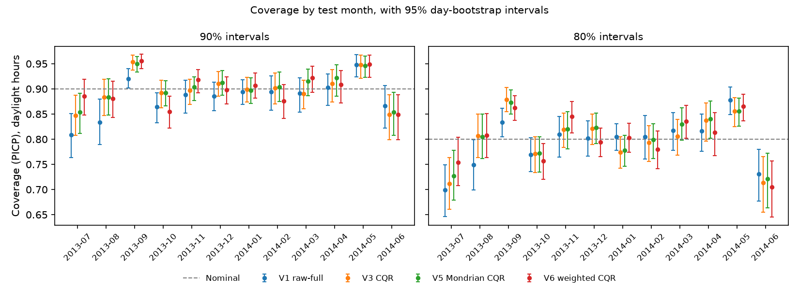
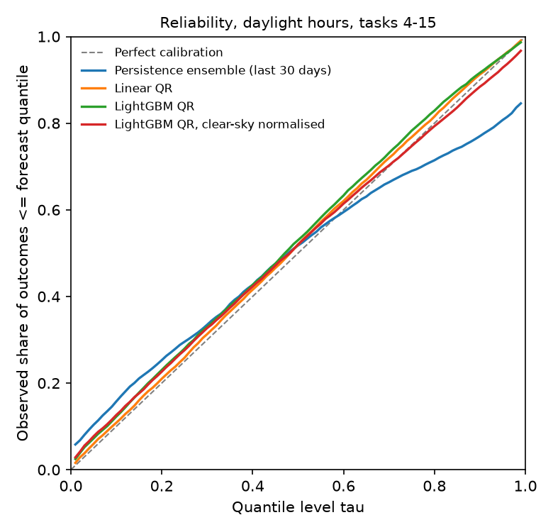
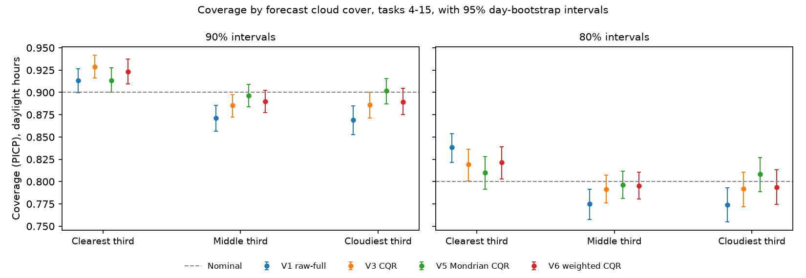
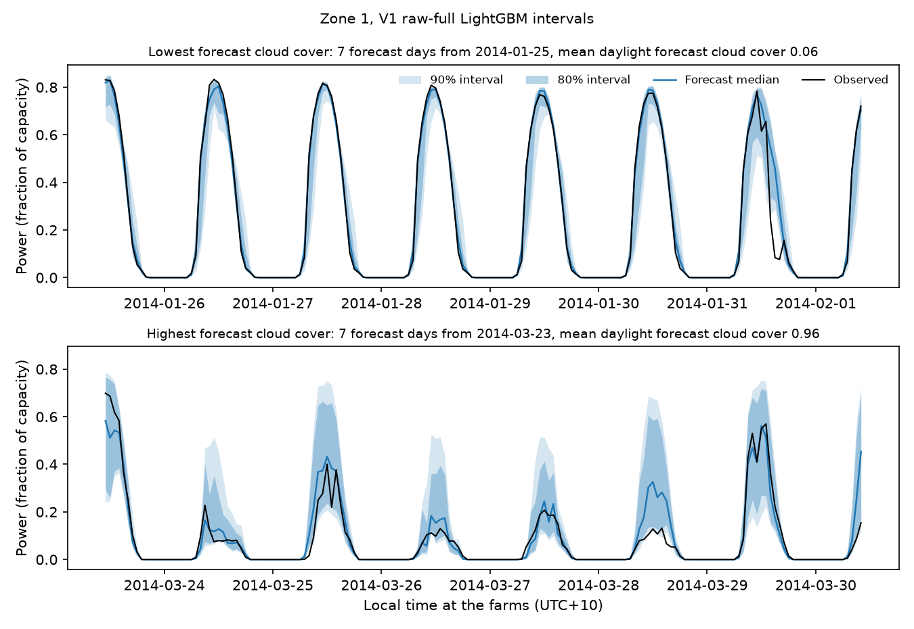

# Do Solar Forecast Intervals Keep Their Promise?

[](https://github.com/Narenkaarthik/pv-interval-calibration/actions/workflows/tests.yml)

A quantile regression forecast of solar power comes with prediction intervals that make a promise: "90% of outcomes will fall inside." This repository tests that promise on the GEFCom2014 solar track, a public benchmark of three Australian solar farms with day-ahead weather forecasts. It forecasts 99 quantiles of hourly power one month at a time, as in the competition, and checks, over a year of months the models have never seen, whether the 80% and 90% intervals cover what they promise: overall, month by month, and under clear versus cloudy forecasts. Two conformal recalibration methods, conformalized quantile regression (CQR) and adaptive conformal inference (ACI), are tested for what they fix and what they cost in interval width. The study then tries two follow-up fixes for the conditional miscoverage it finds (a separate calibration per cloud condition, and recency weighting), and a clear-sky-normalised forecasting model. Every model passes an automatic check against look-ahead leakage, and every reported number is generated by a script.



*Coverage of the 90% (left) and 80% (right) intervals in each of the 12 test months, for the raw model (V1), standard CQR (V3) and the two follow-up fixes (V5 Mondrian CQR, V6 recency-weighted CQR). Bars are 95% confidence intervals from resampling whole days; the dashed line is the promised coverage. ACI (V4) is nearly identical to CQR and is shown in the tables.*

## Short answer

<!-- BEGIN SHORT -->
- **Accuracy.** LightGBM QR averages a pinball loss of 0.0125 over the 12 test months, against 0.0228 for the persistence ensemble and 0.0376 for the official benchmark; predicting power relative to an empirical clear-sky envelope improves it to 0.0121. The competition winner's reported 0.0121 is not reproduced here, so that comparison is approximate.
- **Raw coverage.** Over the year, the raw LightGBM 90% interval falls short of its promise: it covers 88.4% of daylight hours. The 80% interval is on target, at 79.5%. Coverage also swings: the 90% interval covers 80.9% in 2013-07 but 94.8% in 2014-05, and 91.4% under the clearest third of forecasts but 86.9% under the cloudiest.
- **Recalibration.** Using the 60 days before each month, CQR brings yearly 90% coverage to 89.9% and ACI to 90.1% (both on target), at a small width cost: CQR's intervals are 0.013 of capacity wider than those of the uncalibrated split model. But the swings stay: CQR's monthly 90% coverage still ranges from 84.7% to 95.3%, and it covers 92.9% under the clearest forecasts against 88.6% under the cloudiest. Neither method beats the raw full-data model's 90% Winkler score (lower is better): 0.386 for the raw model, against 0.391 for both CQR and ACI.
- **Follow-up fixes.** Calibrating each forecast-cloud tercile separately (Mondrian CQR) shrinks the 90% clear-minus-cloudy coverage gap from 4.3 to 1.2 points, no longer distinguishable from zero, for intervals 0.004 of capacity wider than CQR's. Weighting recent calibration days more (half-life 7 days, chosen on the development months) does not reduce the month-to-month misses: the mean monthly distance from 90% is 2.6 points, against 2.2 for CQR and 2.3 for Mondrian CQR. Both were added after the test results showed the problem; neither has a setting tuned on the test months.
<!-- END SHORT -->

### Key numbers

Generated by `scripts/report.py` from the files in `results/tables/`.

<!-- BEGIN KEY -->
- Track 1, average pinball loss over tasks 4-15: linear QR 0.0191, LightGBM QR 0.0125, clear-sky-normalised LightGBM QR 0.0121, persistence ensemble 0.0228, official benchmark 0.0376. Reported winner: 0.0121 (approximate).
- LightGBM QR, clear-sky normalised improves on the official benchmark by 67.8%.
- LightGBM settings chosen on tasks 1-3: num_leaves = 31, min_child_samples = 100, n_estimators = 300. Chosen on tasks 1-3 as well: ACI step size gamma = 0.005, weighted-CQR half-life 7 days.
- 90% intervals, coverage over tasks 4-15: V1 88.4% (width 0.273), V2 85.8% (width 0.271), V3 89.9% (width 0.283), V4 90.1% (width 0.285), V5 90.4% (width 0.287), V6 90.0% (width 0.285).
- 80% intervals, coverage over tasks 4-15: V1 79.5% (width 0.209), V2 72.2% (width 0.205), V3 80.0% (width 0.216), V4 80.2% (width 0.216), V5 80.5% (width 0.217), V6 80.3% (width 0.217).
- 90%: CQR minus raw-split changes coverage by +4.2 points [+3.8, +4.6] and width by +0.013; ACI minus CQR by +0.2 points [+0.1, +0.3] and +0.001.
- 80%: CQR minus raw-split changes coverage by +7.9 points [+7.3, +8.5] and width by +0.011; ACI minus CQR by +0.1 points [-0.0, +0.2] and +0.000.
- Raw 90% coverage (V1) by forecast cloud tercile: low 91.4%, mid 87.1%, high 86.9%.
- 90% clear-minus-cloudy coverage gap and mean monthly distance from 90% (points): V1 +4.5 points [+2.4, +6.5], monthly miss 2.9; V3 +4.3 points [+2.4, +6.3], monthly miss 2.2; V5 +1.2 points [-0.8, +3.1], monthly miss 2.3; V6 +3.4 points [+1.3, +5.3], monthly miss 2.6.
<!-- END KEY -->

## Results

### Track 1: forecasting the 99 quantiles

Five forecasters, scored with the competition's metric (pinball loss averaged over the 99 quantile levels) on the 12 test months, July 2013 to June 2014.

<!-- BEGIN T1_track1 -->
Averages over the 12 scored tasks (July 2013 - June 2014), equal weight per task. Pinball loss is averaged over the 99 quantile levels. Lower is better.

| Model | Pinball, all hours | Pinball, daylight | MAE of median, daylight |
|---|---:|---:|---:|
| Official benchmark (last year, same hour) | 0.0376 | 0.0721 | 0.1442 |
| Persistence ensemble (last 30 days) | 0.0228 | 0.0441 | 0.1267 |
| Linear QR | 0.0191 | 0.0365 | 0.1032 |
| LightGBM QR | 0.0125 | 0.0243 | 0.0665 |
| LightGBM QR, clear-sky normalised | 0.0121 | 0.0235 | 0.0650 |
| GEFCom2014 winner (reported, approximate) | 0.0121 | – | – |
<!-- END T1_track1 -->

<!-- BEGIN T1_NOTE -->
Linear QR improves on the official benchmark by 49.1% and on the persistence ensemble by 16.0% (average pinball, all hours). Its separately fitted levels crossed (a lower level's quantile above a higher one's) in 8,138 of the 13,770 daylight hours; the largest drop between neighbouring levels averaged 0.0050 of capacity (at most 0.049), and sorting moved quantile values by 0.0005 of capacity on average. 12,240 values above 1 were capped. Every fit converged.

LightGBM QR improves on the official benchmark by 66.6% and on the persistence ensemble by 44.9% (average pinball, all hours). Its separately fitted levels crossed (a lower level's quantile above a higher one's) in 13,770 of the 13,770 daylight hours; the largest drop between neighbouring levels averaged 0.0358 of capacity (at most 0.157), and sorting moved quantile values by 0.0072 of capacity on average. 0 values above 1 were capped.

LightGBM QR, clear-sky normalised improves on the official benchmark by 67.8% and on the persistence ensemble by 46.8% (average pinball, all hours). Its separately fitted levels crossed (a lower level's quantile above a higher one's) in 13,770 of the 13,770 daylight hours; the largest drop between neighbouring levels averaged 0.0262 of capacity (at most 0.153), and sorting moved quantile values by 0.0045 of capacity on average. 46 values above 1 were capped.

No model beats the reported winner's average, so the leakage red flag (a score below 0.0121) did not trigger.

Beyond the full-size checks in the run itself, every quantile model passed the leakage check on all 12 test months (`results/tables/leakage_checks.csv`).
<!-- END T1_NOTE -->



*For each quantile level tau, the share of daylight outcomes at or below the forecast tau-quantile, over the 12 test months. A calibrated forecast follows the diagonal; a curve above it means outcomes fall below the forecast quantiles more often than promised (the quantiles are too high), below it less often.*

Per-month scores: `results/tables/T1_track1_by_task.csv`. Quantile crossing (how often and how much, before sorting), capped values and non-converged linear fits: `results/tables/diagnostics_track1.csv`.

<details>
<summary>LightGBM settings, chosen on the development months (April-June 2013)</summary>

<!-- BEGIN tuning_lightgbm -->
LightGBM tuning on dev tasks 1, 2, 3 (April-June 2013): mean daytime pinball loss at levels 0.05, 0.25, 0.5, 0.75, 0.95; learning rate 0.05.

| num_leaves | min_child_samples | n_estimators | pinball_day_task1 | pinball_day_task2 | pinball_day_task3 | mean_pinball_day | chosen |
|---:|---:|---:|---:|---:|---:|---:|---|
| 15 | 20 | 300 | 0.02266 | 0.02098 | 0.02429 | 0.02265 |  |
| 15 | 20 | 800 | 0.02231 | 0.02051 | 0.02420 | 0.02234 |  |
| 15 | 100 | 300 | 0.02245 | 0.02092 | 0.02432 | 0.02256 |  |
| 15 | 100 | 800 | 0.02204 | 0.02049 | 0.02408 | 0.02220 |  |
| 31 | 20 | 300 | 0.02237 | 0.02061 | 0.02419 | 0.02239 |  |
| 31 | 20 | 800 | 0.02238 | 0.02055 | 0.02418 | 0.02237 |  |
| 31 | 100 | 300 | 0.02195 | 0.02036 | 0.02387 | 0.02206 | **yes** |
| 31 | 100 | 800 | 0.02198 | 0.02022 | 0.02398 | 0.02206 |  |
<!-- END tuning_lightgbm -->

</details>

### Track 2: do the intervals keep their promise?

Versions of the same LightGBM model's 80% interval [q0.10, q0.90] and 90% interval [q0.05, q0.95], scored on the daylight hours of the 12 test months:

- **V1 raw-full**: trained on all history before each test month.
- **V2 raw-split**: trained only up to 60 days before each test month, so those 60 days can be used for calibration.
- **V3 CQR**: V2's intervals widened (or narrowed) by one constant per month, measured on those 60 days.
- **V4 ACI**: like V3, but the level is nudged after every forecast day, depending on whether that day's intervals missed too often or too rarely.
- **V5 Mondrian CQR** (follow-up): like V3, but with a separate constant for each third of the forecast cloud cover.
- **V6 weighted CQR** (follow-up): like V3, but calibration days closer to the test month count more.

<!-- BEGIN T2_track2 -->
Tasks 4-15 (July 2013 - June 2014), daylight hours, all zones pooled (13,770 hours, 365 forecast days). 95% CIs resample whole forecast days (B = 1000, seed 0). ACI step size gamma = 0.005 and weighted-CQR half-life 7 days, both chosen on tasks 1-3. PICP = share of outcomes inside the interval (coverage); MPIW = mean width as a fraction of capacity; Winkler = width plus a penalty for misses (lower is better).

| Variant | Level | PICP [95% CI] | MPIW [95% CI] | Winkler |
|---|---:|---:|---:|---:|
| V1 raw-full | 80% | 79.5% [78.2%, 80.6%] | 0.209 [0.204, 0.215] | 0.310 |
| V2 raw-split | 80% | 72.2% [70.8%, 73.4%] | 0.205 [0.200, 0.211] | 0.319 |
| V3 CQR | 80% | 80.0% [78.9%, 81.1%] | 0.216 [0.211, 0.222] | 0.317 |
| V4 ACI | 80% | 80.2% [79.0%, 81.3%] | 0.216 [0.211, 0.222] | 0.317 |
| V5 Mondrian CQR | 80% | 80.5% [79.3%, 81.6%] | 0.217 [0.212, 0.223] | 0.317 |
| V6 weighted CQR | 80% | 80.3% [79.2%, 81.4%] | 0.217 [0.211, 0.222] | 0.317 |
| V1 raw-full | 90% | 88.4% [87.3%, 89.3%] | 0.273 [0.267, 0.278] | 0.386 |
| V2 raw-split | 90% | 85.8% [84.7%, 86.8%] | 0.271 [0.265, 0.276] | 0.393 |
| V3 CQR | 90% | 89.9% [89.0%, 90.8%] | 0.283 [0.278, 0.289] | 0.391 |
| V4 ACI | 90% | 90.1% [89.2%, 91.0%] | 0.285 [0.280, 0.290] | 0.391 |
| V5 Mondrian CQR | 90% | 90.4% [89.4%, 91.2%] | 0.287 [0.282, 0.293] | 0.390 |
| V6 weighted CQR | 90% | 90.0% [89.1%, 90.9%] | 0.285 [0.279, 0.290] | 0.391 |
<!-- END T2_track2 -->

**Paired differences**, with both variants scored on the same resampled days:

<!-- BEGIN T2_paired_differences -->
Tasks 4-15 (July 2013 - June 2014), daylight hours, all zones pooled (13,770 hours, 365 forecast days). 95% CIs resample whole forecast days (B = 1000, seed 0). ACI step size gamma = 0.005 and weighted-CQR half-life 7 days, both chosen on tasks 1-3. Differences are paired: both variants are scored on the same resampled days.

| Comparison | Level | Coverage change, points [95% CI] | Width change [95% CI] |
|---|---:|---:|---:|
| V3 CQR minus V2 raw-split | 80% | 7.9 [7.3, 8.5] | 0.011 [0.010, 0.012] |
| V4 ACI minus V3 CQR | 80% | 0.1 [-0.0, 0.2] | 0.000 [0.000, 0.000] |
| V5 Mondrian CQR minus V3 CQR | 80% | 0.5 [0.2, 0.7] | 0.001 [0.001, 0.002] |
| V6 weighted CQR minus V3 CQR | 80% | 0.3 [-0.0, 0.6] | 0.000 [-0.000, 0.001] |
| V3 CQR minus V2 raw-split | 90% | 4.2 [3.8, 4.6] | 0.013 [0.012, 0.014] |
| V4 ACI minus V3 CQR | 90% | 0.2 [0.1, 0.3] | 0.001 [0.001, 0.002] |
| V5 Mondrian CQR minus V3 CQR | 90% | 0.4 [0.2, 0.7] | 0.004 [0.003, 0.004] |
| V6 weighted CQR minus V3 CQR | 90% | 0.1 [-0.2, 0.4] | 0.001 [0.000, 0.002] |
<!-- END T2_paired_differences -->

### Does a fix help? Conditional coverage

An interval can keep its promise on average while over-covering clear hours and under-covering cloudy ones, or good months and bad ones. This table measures how *evenly* each variant keeps its promise. V5 and V6 were added after the results above showed the problem, so they are follow-ups rather than part of the original design; neither has any setting tuned on the test months (V5 has no free setting, and V6's half-life was chosen on the development months). The same summary on the development months is in `results/tables/fixes_dev_check.csv`.

<!-- BEGIN T5_conditional -->
Tasks 4-15 (July 2013 - June 2014), daylight hours, all zones pooled (13,770 hours, 365 forecast days). 95% CIs resample whole forecast days (B = 1000, seed 0). ACI step size gamma = 0.005 and weighted-CQR half-life 7 days, both chosen on tasks 1-3. Conditional coverage: how evenly each variant keeps its promise. Clear minus cloudy = coverage under the clearest third of forecasts minus coverage under the cloudiest third (0 means even); worst tercile = the largest distance from the promise among the three terciles; mean monthly miss = the average distance from the promise over the 12 months; worst month = the month furthest from the promise. Distances are in percentage points.

| Variant | Level | PICP | Clear minus cloudy, points [95% CI] | Worst tercile, points off | Mean monthly miss, points | Worst month (points off) | MPIW |
|---|---:|---:|---:|---:|---:|---:|---:|
| V1 raw-full | 80% | 79.5% | 6.4 [3.8, 8.8] | 3.8 | 3.5 | 2013-07 (10.1) | 0.209 |
| V2 raw-split | 80% | 72.2% | -1.2 [-4.1, 1.6] | 8.7 | 8.3 | 2013-07 (16.4) | 0.205 |
| V3 CQR | 80% | 80.0% | 2.7 [0.0, 5.3] | 1.9 | 3.8 | 2013-07 (8.8) | 0.216 |
| V4 ACI | 80% | 80.2% | 2.8 [0.1, 5.3] | 2.1 | 3.7 | 2014-06 (8.8) | 0.216 |
| V5 Mondrian CQR | 80% | 80.5% | 0.2 [-2.5, 2.9] | 1.0 | 3.8 | 2014-06 (7.9) | 0.217 |
| V6 weighted CQR | 80% | 80.3% | 2.7 [-0.0, 5.3] | 2.1 | 3.7 | 2014-06 (9.6) | 0.217 |
| V1 raw-full | 90% | 88.4% | 4.5 [2.4, 6.5] | 3.1 | 2.9 | 2013-07 (9.1) | 0.273 |
| V2 raw-split | 90% | 85.8% | 2.3 [0.1, 4.5] | 5.3 | 4.9 | 2013-07 (13.0) | 0.271 |
| V3 CQR | 90% | 89.9% | 4.3 [2.4, 6.3] | 2.9 | 2.2 | 2013-09 (5.3) | 0.283 |
| V4 ACI | 90% | 90.1% | 4.4 [2.4, 6.3] | 3.1 | 2.1 | 2013-09 (5.5) | 0.285 |
| V5 Mondrian CQR | 90% | 90.4% | 1.2 [-0.8, 3.1] | 1.4 | 2.3 | 2013-09 (5.0) | 0.287 |
| V6 weighted CQR | 90% | 90.0% | 3.4 [1.3, 5.3] | 2.3 | 2.6 | 2013-09 (5.5) | 0.285 |
<!-- END T5_conditional -->



*Coverage under the clearest, middle and cloudiest third of forecast cloud cover, with 95% confidence intervals. The terciles use the forecast, known in advance, never the observed weather, which would partly select on the outcome.*

<details>
<summary>Coverage by forecast cloud tercile, all variants (T3)</summary>

<!-- BEGIN T3_by_cloud -->
Tasks 4-15 (July 2013 - June 2014), daylight hours, all zones pooled (13,770 hours, 365 forecast days). 95% CIs resample whole forecast days (B = 1000, seed 0). ACI step size gamma = 0.005 and weighted-CQR half-life 7 days, both chosen on tasks 1-3. Terciles of hourly forecast total cloud cover (tcc), cut at 0.076 and 0.696: the 1/3 and 2/3 quantiles of daylight tcc before 2013-07-01.

| Variant | Forecast cloud | Level | PICP [95% CI] | MPIW |
|---|---|---:|---:|---:|
| V1 raw-full | low | 80% | 83.8% [82.1%, 85.4%] | 0.149 |
| V1 raw-full | mid | 80% | 77.5% [75.7%, 79.1%] | 0.234 |
| V1 raw-full | high | 80% | 77.4% [75.5%, 79.3%] | 0.241 |
| V2 raw-split | low | 80% | 71.3% [69.3%, 73.2%] | 0.145 |
| V2 raw-split | mid | 80% | 72.6% [70.9%, 74.2%] | 0.228 |
| V2 raw-split | high | 80% | 72.6% [70.4%, 74.6%] | 0.238 |
| V3 CQR | low | 80% | 81.9% [80.1%, 83.6%] | 0.157 |
| V3 CQR | mid | 80% | 79.1% [77.6%, 80.8%] | 0.239 |
| V3 CQR | high | 80% | 79.2% [77.2%, 81.1%] | 0.248 |
| V4 ACI | low | 80% | 82.1% [80.2%, 83.8%] | 0.157 |
| V4 ACI | mid | 80% | 79.3% [77.7%, 80.9%] | 0.240 |
| V4 ACI | high | 80% | 79.2% [77.3%, 81.2%] | 0.248 |
| V5 Mondrian CQR | low | 80% | 81.0% [79.2%, 82.8%] | 0.155 |
| V5 Mondrian CQR | mid | 80% | 79.7% [78.1%, 81.2%] | 0.240 |
| V5 Mondrian CQR | high | 80% | 80.8% [78.9%, 82.7%] | 0.252 |
| V6 weighted CQR | low | 80% | 82.1% [80.3%, 83.9%] | 0.157 |
| V6 weighted CQR | mid | 80% | 79.5% [78.0%, 81.1%] | 0.240 |
| V6 weighted CQR | high | 80% | 79.4% [77.4%, 81.3%] | 0.248 |
| V1 raw-full | low | 90% | 91.4% [90.0%, 92.6%] | 0.213 |
| V1 raw-full | mid | 90% | 87.1% [85.6%, 88.5%] | 0.298 |
| V1 raw-full | high | 90% | 86.9% [85.3%, 88.5%] | 0.304 |
| V2 raw-split | low | 90% | 87.5% [85.9%, 89.1%] | 0.212 |
| V2 raw-split | mid | 90% | 84.7% [83.3%, 86.1%] | 0.294 |
| V2 raw-split | high | 90% | 85.2% [83.5%, 86.9%] | 0.301 |
| V3 CQR | low | 90% | 92.9% [91.6%, 94.2%] | 0.226 |
| V3 CQR | mid | 90% | 88.6% [87.3%, 89.8%] | 0.307 |
| V3 CQR | high | 90% | 88.6% [87.1%, 90.0%] | 0.313 |
| V4 ACI | low | 90% | 93.1% [91.8%, 94.4%] | 0.227 |
| V4 ACI | mid | 90% | 88.8% [87.5%, 90.0%] | 0.308 |
| V4 ACI | high | 90% | 88.7% [87.2%, 90.2%] | 0.314 |
| V5 Mondrian CQR | low | 90% | 91.4% [90.0%, 92.8%] | 0.223 |
| V5 Mondrian CQR | mid | 90% | 89.6% [88.4%, 90.9%] | 0.312 |
| V5 Mondrian CQR | high | 90% | 90.2% [88.7%, 91.5%] | 0.321 |
| V6 weighted CQR | low | 90% | 92.3% [91.0%, 93.7%] | 0.226 |
| V6 weighted CQR | mid | 90% | 89.0% [87.7%, 90.3%] | 0.309 |
| V6 weighted CQR | high | 90% | 89.0% [87.5%, 90.5%] | 0.315 |
<!-- END T3_by_cloud -->

</details>

<details>
<summary>Coverage and width by test month, all variants (T4)</summary>

<!-- BEGIN T4_by_month -->
Tasks 4-15 (July 2013 - June 2014), daylight hours, all zones pooled (13,770 hours, 365 forecast days). 95% CIs resample whole forecast days (B = 1000, seed 0). ACI step size gamma = 0.005 and weighted-CQR half-life 7 days, both chosen on tasks 1-3.

| Variant | Month | Level | PICP [95% CI] | MPIW [95% CI] |
|---|---:|---:|---:|---:|
| V1 raw-full | 2013-07 | 80% | 69.9% [64.6%, 74.9%] | 0.202 [0.186, 0.218] |
| V1 raw-full | 2013-08 | 80% | 75.0% [69.9%, 79.9%] | 0.221 [0.203, 0.239] |
| V1 raw-full | 2013-09 | 80% | 83.4% [80.5%, 86.1%] | 0.227 [0.208, 0.247] |
| V1 raw-full | 2013-10 | 80% | 77.0% [73.6%, 80.3%] | 0.197 [0.180, 0.214] |
| V1 raw-full | 2013-11 | 80% | 80.9% [76.4%, 84.5%] | 0.220 [0.201, 0.237] |
| V1 raw-full | 2013-12 | 80% | 80.2% [76.7%, 83.7%] | 0.193 [0.179, 0.208] |
| V1 raw-full | 2014-01 | 80% | 80.5% [77.8%, 83.0%] | 0.170 [0.153, 0.188] |
| V1 raw-full | 2014-02 | 80% | 80.5% [76.1%, 84.7%] | 0.186 [0.168, 0.205] |
| V1 raw-full | 2014-03 | 80% | 81.7% [77.8%, 85.3%] | 0.238 [0.224, 0.252] |
| V1 raw-full | 2014-04 | 80% | 81.7% [77.6%, 85.0%] | 0.215 [0.198, 0.229] |
| V1 raw-full | 2014-05 | 80% | 87.8% [84.9%, 90.3%] | 0.228 [0.210, 0.247] |
| V1 raw-full | 2014-06 | 80% | 73.1% [67.7%, 77.9%] | 0.232 [0.213, 0.251] |
| V2 raw-split | 2013-07 | 80% | 63.6% [58.8%, 68.4%] | 0.193 [0.176, 0.209] |
| V2 raw-split | 2013-08 | 80% | 64.8% [60.0%, 69.3%] | 0.206 [0.187, 0.225] |
| V2 raw-split | 2013-09 | 80% | 76.1% [72.6%, 79.3%] | 0.217 [0.196, 0.238] |
| V2 raw-split | 2013-10 | 80% | 68.7% [65.1%, 72.4%] | 0.191 [0.173, 0.209] |
| V2 raw-split | 2013-11 | 80% | 73.5% [68.8%, 77.4%] | 0.217 [0.199, 0.233] |
| V2 raw-split | 2013-12 | 80% | 71.7% [68.5%, 74.9%] | 0.192 [0.178, 0.207] |
| V2 raw-split | 2014-01 | 80% | 70.2% [67.0%, 73.5%] | 0.170 [0.153, 0.188] |
| V2 raw-split | 2014-02 | 80% | 71.4% [66.8%, 75.6%] | 0.186 [0.169, 0.203] |
| V2 raw-split | 2014-03 | 80% | 77.0% [73.2%, 80.5%] | 0.236 [0.223, 0.250] |
| V2 raw-split | 2014-04 | 80% | 75.6% [70.3%, 80.3%] | 0.213 [0.196, 0.229] |
| V2 raw-split | 2014-05 | 80% | 83.2% [79.9%, 85.9%] | 0.228 [0.210, 0.246] |
| V2 raw-split | 2014-06 | 80% | 70.7% [64.9%, 75.8%] | 0.233 [0.213, 0.252] |
| V3 CQR | 2013-07 | 80% | 71.2% [66.0%, 76.4%] | 0.204 [0.187, 0.221] |
| V3 CQR | 2013-08 | 80% | 80.7% [76.4%, 85.0%] | 0.233 [0.214, 0.252] |
| V3 CQR | 2013-09 | 80% | 87.9% [85.5%, 90.3%] | 0.241 [0.220, 0.262] |
| V3 CQR | 2013-10 | 80% | 77.1% [73.4%, 80.4%] | 0.202 [0.184, 0.220] |
| V3 CQR | 2013-11 | 80% | 81.9% [78.4%, 85.1%] | 0.228 [0.210, 0.244] |
| V3 CQR | 2013-12 | 80% | 82.1% [78.9%, 85.0%] | 0.205 [0.191, 0.220] |
| V3 CQR | 2014-01 | 80% | 77.4% [74.2%, 80.5%] | 0.176 [0.160, 0.194] |
| V3 CQR | 2014-02 | 80% | 79.3% [75.6%, 82.7%] | 0.194 [0.177, 0.211] |
| V3 CQR | 2014-03 | 80% | 80.6% [76.9%, 84.0%] | 0.242 [0.229, 0.256] |
| V3 CQR | 2014-04 | 80% | 83.7% [79.6%, 87.2%] | 0.220 [0.203, 0.236] |
| V3 CQR | 2014-05 | 80% | 85.6% [82.5%, 88.2%] | 0.231 [0.213, 0.249] |
| V3 CQR | 2014-06 | 80% | 71.3% [65.5%, 76.5%] | 0.233 [0.214, 0.253] |
| V4 ACI | 2013-07 | 80% | 72.8% [68.2%, 77.8%] | 0.207 [0.190, 0.223] |
| V4 ACI | 2013-08 | 80% | 81.3% [76.9%, 85.6%] | 0.236 [0.217, 0.255] |
| V4 ACI | 2013-09 | 80% | 88.1% [85.8%, 90.5%] | 0.242 [0.220, 0.263] |
| V4 ACI | 2013-10 | 80% | 77.1% [73.4%, 80.4%] | 0.202 [0.184, 0.220] |
| V4 ACI | 2013-11 | 80% | 82.4% [78.9%, 85.7%] | 0.229 [0.210, 0.245] |
| V4 ACI | 2013-12 | 80% | 81.9% [78.6%, 84.7%] | 0.204 [0.191, 0.220] |
| V4 ACI | 2014-01 | 80% | 77.3% [74.1%, 80.5%] | 0.176 [0.160, 0.194] |
| V4 ACI | 2014-02 | 80% | 79.2% [75.4%, 82.7%] | 0.194 [0.177, 0.211] |
| V4 ACI | 2014-03 | 80% | 80.9% [77.1%, 84.3%] | 0.243 [0.229, 0.256] |
| V4 ACI | 2014-04 | 80% | 83.1% [79.0%, 86.8%] | 0.220 [0.202, 0.235] |
| V4 ACI | 2014-05 | 80% | 84.9% [81.7%, 87.6%] | 0.230 [0.213, 0.248] |
| V4 ACI | 2014-06 | 80% | 71.2% [65.4%, 76.3%] | 0.233 [0.214, 0.253] |
| V5 Mondrian CQR | 2013-07 | 80% | 72.7% [67.9%, 77.8%] | 0.207 [0.189, 0.223] |
| V5 Mondrian CQR | 2013-08 | 80% | 80.5% [76.1%, 85.0%] | 0.232 [0.214, 0.252] |
| V5 Mondrian CQR | 2013-09 | 80% | 87.3% [85.0%, 89.8%] | 0.242 [0.219, 0.263] |
| V5 Mondrian CQR | 2013-10 | 80% | 77.2% [73.5%, 80.5%] | 0.202 [0.184, 0.220] |
| V5 Mondrian CQR | 2013-11 | 80% | 82.0% [78.1%, 85.4%] | 0.229 [0.210, 0.245] |
| V5 Mondrian CQR | 2013-12 | 80% | 82.3% [79.2%, 85.2%] | 0.205 [0.191, 0.221] |
| V5 Mondrian CQR | 2014-01 | 80% | 77.7% [74.6%, 80.8%] | 0.177 [0.160, 0.194] |
| V5 Mondrian CQR | 2014-02 | 80% | 79.9% [76.1%, 83.1%] | 0.196 [0.178, 0.214] |
| V5 Mondrian CQR | 2014-03 | 80% | 83.0% [79.8%, 86.3%] | 0.248 [0.235, 0.261] |
| V5 Mondrian CQR | 2014-04 | 80% | 84.1% [80.2%, 87.6%] | 0.223 [0.205, 0.238] |
| V5 Mondrian CQR | 2014-05 | 80% | 85.6% [82.6%, 88.1%] | 0.231 [0.214, 0.250] |
| V5 Mondrian CQR | 2014-06 | 80% | 72.1% [66.3%, 77.2%] | 0.234 [0.215, 0.254] |
| V6 weighted CQR | 2013-07 | 80% | 75.3% [70.8%, 80.3%] | 0.212 [0.195, 0.229] |
| V6 weighted CQR | 2013-08 | 80% | 80.8% [76.4%, 85.1%] | 0.233 [0.214, 0.252] |
| V6 weighted CQR | 2013-09 | 80% | 86.2% [83.7%, 88.6%] | 0.235 [0.213, 0.256] |
| V6 weighted CQR | 2013-10 | 80% | 75.6% [72.0%, 79.1%] | 0.198 [0.180, 0.216] |
| V6 weighted CQR | 2013-11 | 80% | 84.6% [81.3%, 87.5%] | 0.237 [0.218, 0.253] |
| V6 weighted CQR | 2013-12 | 80% | 79.4% [76.6%, 82.2%] | 0.199 [0.186, 0.215] |
| V6 weighted CQR | 2014-01 | 80% | 80.3% [77.4%, 83.2%] | 0.180 [0.163, 0.198] |
| V6 weighted CQR | 2014-02 | 80% | 78.0% [74.1%, 81.6%] | 0.192 [0.175, 0.209] |
| V6 weighted CQR | 2014-03 | 80% | 83.5% [80.2%, 86.7%] | 0.248 [0.234, 0.261] |
| V6 weighted CQR | 2014-04 | 80% | 81.3% [76.8%, 85.2%] | 0.217 [0.200, 0.232] |
| V6 weighted CQR | 2014-05 | 80% | 86.5% [83.6%, 88.9%] | 0.232 [0.215, 0.250] |
| V6 weighted CQR | 2014-06 | 80% | 70.4% [64.5%, 75.7%] | 0.233 [0.213, 0.252] |
| V1 raw-full | 2013-07 | 90% | 80.9% [76.3%, 85.1%] | 0.265 [0.247, 0.282] |
| V1 raw-full | 2013-08 | 90% | 83.4% [78.9%, 87.9%] | 0.283 [0.265, 0.300] |
| V1 raw-full | 2013-09 | 90% | 92.1% [90.2%, 94.0%] | 0.289 [0.268, 0.309] |
| V1 raw-full | 2013-10 | 90% | 86.4% [83.2%, 89.2%] | 0.257 [0.239, 0.276] |
| V1 raw-full | 2013-11 | 90% | 88.8% [85.2%, 91.7%] | 0.286 [0.266, 0.304] |
| V1 raw-full | 2013-12 | 90% | 88.5% [85.6%, 91.4%] | 0.255 [0.240, 0.271] |
| V1 raw-full | 2014-01 | 90% | 89.5% [86.9%, 91.8%] | 0.233 [0.216, 0.251] |
| V1 raw-full | 2014-02 | 90% | 89.4% [85.8%, 92.6%] | 0.246 [0.227, 0.266] |
| V1 raw-full | 2014-03 | 90% | 89.1% [85.4%, 92.2%] | 0.307 [0.293, 0.320] |
| V1 raw-full | 2014-04 | 90% | 90.3% [86.7%, 93.0%] | 0.277 [0.261, 0.291] |
| V1 raw-full | 2014-05 | 90% | 94.8% [92.3%, 96.8%] | 0.295 [0.279, 0.312] |
| V1 raw-full | 2014-06 | 90% | 86.7% [82.2%, 90.6%] | 0.303 [0.288, 0.319] |
| V2 raw-split | 2013-07 | 90% | 77.0% [72.4%, 81.7%] | 0.255 [0.237, 0.272] |
| V2 raw-split | 2013-08 | 90% | 80.4% [75.8%, 84.8%] | 0.276 [0.258, 0.294] |
| V2 raw-split | 2013-09 | 90% | 89.8% [87.4%, 92.0%] | 0.281 [0.260, 0.302] |
| V2 raw-split | 2013-10 | 90% | 83.3% [79.9%, 86.5%] | 0.258 [0.238, 0.279] |
| V2 raw-split | 2013-11 | 90% | 86.0% [82.5%, 88.7%] | 0.286 [0.268, 0.302] |
| V2 raw-split | 2013-12 | 90% | 86.7% [84.0%, 89.2%] | 0.254 [0.239, 0.269] |
| V2 raw-split | 2014-01 | 90% | 86.0% [83.2%, 88.6%] | 0.236 [0.220, 0.253] |
| V2 raw-split | 2014-02 | 90% | 87.2% [83.7%, 90.5%] | 0.253 [0.236, 0.270] |
| V2 raw-split | 2014-03 | 90% | 86.4% [83.0%, 89.4%] | 0.297 [0.285, 0.309] |
| V2 raw-split | 2014-04 | 90% | 87.4% [83.2%, 90.8%] | 0.278 [0.264, 0.291] |
| V2 raw-split | 2014-05 | 90% | 93.5% [90.7%, 95.8%] | 0.291 [0.275, 0.307] |
| V2 raw-split | 2014-06 | 90% | 84.9% [79.9%, 88.9%] | 0.300 [0.285, 0.315] |
| V3 CQR | 2013-07 | 90% | 84.7% [80.7%, 88.7%] | 0.271 [0.253, 0.288] |
| V3 CQR | 2013-08 | 90% | 88.4% [84.8%, 91.9%] | 0.307 [0.288, 0.325] |
| V3 CQR | 2013-09 | 90% | 95.3% [93.7%, 96.7%] | 0.316 [0.295, 0.338] |
| V3 CQR | 2013-10 | 90% | 89.2% [86.3%, 91.7%] | 0.274 [0.254, 0.295] |
| V3 CQR | 2013-11 | 90% | 89.7% [86.9%, 91.9%] | 0.295 [0.277, 0.311] |
| V3 CQR | 2013-12 | 90% | 91.0% [88.5%, 93.4%] | 0.270 [0.255, 0.286] |
| V3 CQR | 2014-01 | 90% | 89.9% [87.4%, 92.3%] | 0.244 [0.227, 0.261] |
| V3 CQR | 2014-02 | 90% | 90.2% [87.0%, 93.2%] | 0.258 [0.241, 0.275] |
| V3 CQR | 2014-03 | 90% | 89.0% [86.0%, 91.7%] | 0.302 [0.290, 0.314] |
| V3 CQR | 2014-04 | 90% | 91.0% [87.4%, 93.8%] | 0.285 [0.271, 0.298] |
| V3 CQR | 2014-05 | 90% | 94.8% [92.1%, 96.7%] | 0.296 [0.280, 0.312] |
| V3 CQR | 2014-06 | 90% | 84.9% [79.9%, 88.9%] | 0.300 [0.284, 0.315] |
| V4 ACI | 2013-07 | 90% | 85.8% [81.9%, 89.4%] | 0.273 [0.256, 0.291] |
| V4 ACI | 2013-08 | 90% | 88.8% [85.1%, 92.4%] | 0.313 [0.296, 0.331] |
| V4 ACI | 2013-09 | 90% | 95.5% [94.0%, 96.9%] | 0.322 [0.301, 0.343] |
| V4 ACI | 2013-10 | 90% | 89.4% [86.5%, 91.8%] | 0.275 [0.255, 0.296] |
| V4 ACI | 2013-11 | 90% | 90.1% [87.3%, 92.3%] | 0.296 [0.278, 0.313] |
| V4 ACI | 2013-12 | 90% | 91.0% [88.5%, 93.4%] | 0.271 [0.255, 0.286] |
| V4 ACI | 2014-01 | 90% | 90.3% [87.8%, 92.8%] | 0.245 [0.228, 0.262] |
| V4 ACI | 2014-02 | 90% | 90.1% [87.0%, 93.1%] | 0.258 [0.242, 0.275] |
| V4 ACI | 2014-03 | 90% | 89.1% [86.0%, 91.9%] | 0.303 [0.290, 0.315] |
| V4 ACI | 2014-04 | 90% | 91.0% [87.4%, 93.8%] | 0.285 [0.271, 0.298] |
| V4 ACI | 2014-05 | 90% | 94.7% [91.8%, 96.7%] | 0.295 [0.279, 0.311] |
| V4 ACI | 2014-06 | 90% | 84.7% [79.7%, 88.7%] | 0.299 [0.284, 0.315] |
| V5 Mondrian CQR | 2013-07 | 90% | 85.4% [81.2%, 89.2%] | 0.276 [0.257, 0.295] |
| V5 Mondrian CQR | 2013-08 | 90% | 88.4% [84.8%, 92.0%] | 0.313 [0.296, 0.328] |
| V5 Mondrian CQR | 2013-09 | 90% | 95.0% [93.4%, 96.5%] | 0.318 [0.296, 0.338] |
| V5 Mondrian CQR | 2013-10 | 90% | 89.2% [86.6%, 91.6%] | 0.275 [0.254, 0.296] |
| V5 Mondrian CQR | 2013-11 | 90% | 90.4% [87.7%, 92.4%] | 0.300 [0.281, 0.318] |
| V5 Mondrian CQR | 2013-12 | 90% | 91.3% [88.8%, 93.6%] | 0.273 [0.256, 0.291] |
| V5 Mondrian CQR | 2014-01 | 90% | 89.7% [87.2%, 92.2%] | 0.243 [0.225, 0.260] |
| V5 Mondrian CQR | 2014-02 | 90% | 90.4% [87.5%, 93.3%] | 0.261 [0.243, 0.278] |
| V5 Mondrian CQR | 2014-03 | 90% | 91.5% [88.7%, 94.0%] | 0.315 [0.302, 0.328] |
| V5 Mondrian CQR | 2014-04 | 90% | 92.2% [88.6%, 94.8%] | 0.292 [0.278, 0.306] |
| V5 Mondrian CQR | 2014-05 | 90% | 94.7% [92.3%, 96.6%] | 0.297 [0.280, 0.313] |
| V5 Mondrian CQR | 2014-06 | 90% | 85.3% [80.7%, 89.3%] | 0.301 [0.285, 0.317] |
| V6 weighted CQR | 2013-07 | 90% | 88.5% [84.8%, 92.0%] | 0.291 [0.273, 0.308] |
| V6 weighted CQR | 2013-08 | 90% | 88.0% [84.3%, 91.6%] | 0.301 [0.283, 0.319] |
| V6 weighted CQR | 2013-09 | 90% | 95.5% [94.0%, 96.9%] | 0.321 [0.300, 0.343] |
| V6 weighted CQR | 2013-10 | 90% | 85.5% [82.2%, 88.6%] | 0.263 [0.243, 0.284] |
| V6 weighted CQR | 2013-11 | 90% | 91.8% [89.3%, 93.8%] | 0.304 [0.287, 0.321] |
| V6 weighted CQR | 2013-12 | 90% | 89.8% [87.0%, 92.4%] | 0.263 [0.248, 0.279] |
| V6 weighted CQR | 2014-01 | 90% | 90.7% [88.2%, 93.2%] | 0.245 [0.229, 0.262] |
| V6 weighted CQR | 2014-02 | 90% | 87.6% [84.2%, 90.8%] | 0.253 [0.236, 0.270] |
| V6 weighted CQR | 2014-03 | 90% | 92.2% [89.3%, 94.5%] | 0.315 [0.302, 0.327] |
| V6 weighted CQR | 2014-04 | 90% | 90.8% [87.2%, 93.6%] | 0.284 [0.269, 0.296] |
| V6 weighted CQR | 2014-05 | 90% | 94.9% [92.3%, 96.7%] | 0.298 [0.282, 0.314] |
| V6 weighted CQR | 2014-06 | 90% | 84.9% [79.9%, 88.9%] | 0.300 [0.285, 0.315] |
<!-- END T4_by_month -->

</details>



*Zone 1: the raw-full (V1) forecast median with 80% and 90% bands against observed power, in local time. The two 7-day periods are chosen by a fixed rule, not by eye: among all runs of 7 consecutive forecast days in the test months, the one with the lowest and the one with the highest mean daylight forecast cloud cover.*

Diagnostics: each month's CQR, Mondrian and weighted adjustments (`results/tables/cqr_adjustments.csv`), ACI's day-by-day level (`results/tables/aci_alpha_path.csv`), the step-size and half-life selections (`results/tables/aci_gamma_selection.csv`, `results/tables/weighted_half_life_selection.csv`) and edge-case counts (`results/tables/track2_diagnostics.csv`).

## Methods

**Protocol.** The competition defines 15 monthly tasks. Task *n* trains on everything up to 00:00 UTC on day 1 of its test month and forecasts that whole month; task 1 tests April 2013 and task 15 June 2014. Tasks 1-3 (April-June 2013) are used only for development: every choice (the LightGBM settings, ACI's step size and the weighting half-life) is made on them and frozen. Tasks 4-15 (July 2013 to June 2014) are the test months and are reported. Splits are always chronological.

**Leakage guard.** `pvcal.leakage.assert_no_lookahead` reruns a forecaster twice on altered data: once with every test-month outcome replaced by an impossible value (no forecast may change), and once with every weather forecast issued after the opening test day replaced (that day's forecasts may not change). Every forecaster passes it in the tests, and the scripts refuse to score a model that fails it. ACI gets a day-by-day version: corrupting the outcomes from day *d* onward must leave every interval up to day *d* unchanged. The calibration variants are checked the same way: corrupting test-month outcomes must not move any V2, V3, V5 or V6 interval.

**Forecasters.**
- *Official benchmark*: last year's power at the same hour, used as every quantile.
- *Persistence ensemble*: for each zone and hour of the day, the empirical quantiles of the last 30 days of observed power.
- *Linear quantile regression* (Koenker & Bassett, 1978), fitted with statsmodels `QuantReg`, one fit per quantile level, on daylight hours. Inputs: the 12 weather forecast variables standardised with training statistics, the day of the year as a sine and cosine, and the hour and zone as 0/1 indicator columns.
- *LightGBM quantile regression*: one gradient-boosted tree model per quantile level, trained on the pinball loss. Inputs: the 12 weather variables, the hour, the day of the year as a sine and cosine, and the zone as a category. Its settings are chosen on the development months from an 8-point grid.
- *Clear-sky-normalised LightGBM*: the same model and settings, but predicting power *relative to* an empirical clear-sky envelope. The farm locations are undisclosed, so the sun's position cannot be computed; instead, for each zone, hour and day of year, the envelope is the 95th percentile of past power within 15 days of that date, from training data only. The model also gets the forecast's own clear-sky index (forecast radiation over its envelope) and the transmittance (surface over top-of-atmosphere radiation). Each training hour is weighted by its envelope, so the loss equals the pinball loss on power, and the predicted ratios are multiplied back. Note that the dataset's top-of-atmosphere radiation is *net* (incoming minus reflected), so clouds lower it too; it is not a clear-sky value by itself.
- *Post-processing, for every model*: sort each row's quantiles, clip to [0, 1], and set forecast-night hours to zero.

**Quantile crossing.** Each quantile level is fitted separately, so nothing stops a 42% quantile from landing above the 43% one. Sorting each row afterwards, known as rearrangement, is a standard remedy and is known to bring estimated quantile curves closer to the true ones (Chernozhukov, Fernández-Val & Galichon, 2010). `results/tables/diagnostics_track1.csv` reports how often crossing happened and how large it was before sorting. Methods that avoid crossing by construction include quantile regression forests (all quantiles from one fitted conditional distribution), modelling a base quantile plus non-negative increments, distributional boosting, and jointly fitted quantiles with monotonicity constraints; they are not used here.

**Recalibration.**
- *CQR* (Romano, Patterson & Candès, 2019). On the 60 days before the test month, measure how far each daylight outcome fell outside the split model's interval (its conformity score), take the ceil((n + 1)(1 - alpha))-th smallest score, and widen every interval in the month by it. The "+ 1" counts the test hour itself: if calibration and test data are exchangeable, its rank among all n + 1 scores is uniform, and this rank guarantees at least the promised coverage. Seasonal change breaks exchangeability, which is what this study tests.
- *ACI* (Gibbs & Candès, 2021), updated daily. Start from the promised miss rate alpha. Each day, apply the CQR rule at level 1 - alpha_d; once the day is over, set alpha_{d+1} = alpha_d + gamma (alpha - that day's miss rate). The step size gamma trades speed for stability: a large gamma reacts quickly to a shift but makes the intervals jump with every noisy day; a small gamma is stable but slow, and gamma = 0 is plain CQR. It is chosen on the development months.
- *Mondrian CQR* (Vovk, Gammerman & Shafer, 2005): CQR computed separately within each forecast-cloud tercile of the calibration window, so clear and cloudy hours get their own adjustment. The price is fewer calibration hours per adjustment.
- *Weighted CQR* (Barber, Candès, Ramdas & Tibshirani, 2023): calibration day *d* days before the test month gets weight 0.5^(d / half-life), and the adjustment is the weighted version of the CQR quantile. With equal weights it is exactly CQR.

**Metrics.** Pinball loss over 99 levels (the competition score); the mean absolute error of the median; coverage (PICP, the share of outcomes inside the interval); mean width (MPIW; equal to PINAW here, because power is already a fraction of capacity); and the Winkler score, which adds 2/alpha times the size of any miss to the width. Interval metrics use daylight hours only: at night the forecast and the outcome are both zero, so every interval would "cover" for free.

**Uncertainty.** 95% percentile confidence intervals from 1,000 bootstrap resamples of whole forecast days. Hours within a day share one weather forecast and one weather situation, so their errors are correlated; resampling single hours would treat them as independent and give intervals that are too narrow. Differences between variants are paired: both are scored on the same resampled days.

Every modelling choice and its reason is recorded in [DECISIONS.md](DECISIONS.md); all fixed settings are named constants in `src/pvcal/config.py`.

## Data

The data is **not included** in this repository. It is the solar track of the Global Energy Forecasting Competition 2014, published with Hong et al. (2016); please cite that paper if you use it. It has its own source and terms of use and is not redistributed here. [data/README.md](data/README.md) explains where to download it and where to put it (`data/raw/Solar`).

What the code relies on (each point is checked by `tests/test_real_data.py`):

- Three solar farms ("zones"), hourly, April 2012 to June 2014. Power is a fraction of each farm's capacity.
- Timestamps are UTC and hour-ending (`20120401 01:00` covers 00:00-01:00 UTC). Output peaks at 02:00-03:00 UTC, near local noon at UTC+10. Zone 2 peaks about an hour later than zones 1 and 3, so the models are told the zone.
- 12 ECMWF weather forecast variables, issued at 00:00 UTC for lead times 1-24 h; the row stamped `00:00` is lead 24 of the previous day's run.
- Solar and thermal radiation, top-of-atmosphere radiation and precipitation arrive as running totals since the issue time and are differenced into hourly values (W/m² and mm).
- Hours with a forecast solar radiation of at most 1 W/m² are treated as night; observed power is essentially zero at those hours.
- The official benchmark (last year's power at the same hour, in all 99 quantiles) is rebuilt exactly by `pvcal.baselines.yearly_persistence`.

## Reproduce

Python 3.10 or newer. On macOS or Linux:

```bash
git clone https://github.com/Narenkaarthik/pv-interval-calibration.git
cd pv-interval-calibration
python3 -m venv .venv
source .venv/bin/activate
pip install -e ".[dev,models]"
pytest
python scripts/run_all.py --data data/raw/Solar
```

On Windows, activate the environment with `.venv\Scripts\activate` instead of `source .venv/bin/activate`; the other commands are the same. On macOS, LightGBM also needs OpenMP (`brew install libomp`). Download the data into `data/raw/Solar` before the last command (see [data/README.md](data/README.md)); without it, the real-data tests are skipped.

`run_all.py` regenerates every table and figure in `results/` and the results sections of this README. The steps can also be run one at a time, in this order: `run_baselines.py`, `tune_lightgbm.py`, `run_track1.py`, `run_track2.py`, `report.py` (all in `scripts/`).

<!-- BEGIN RUNTIME -->
The last full run took 103.9 minutes before the report step (`run_baselines.py` 0.1 min, `tune_lightgbm.py` 1.5 min, `run_track1.py` 101.4 min, `run_track2.py` 0.9 min) on a machine with 16 logical CPU cores.
<!-- END RUNTIME -->

### Forecast a month

The installed package provides a command that trains a model on everything before a month and writes that month's 99 quantiles for every zone and hour:

```bash
pvcal-forecast --data data/raw/Solar --month 2014-06 --model lightgbm --out june.csv
```

`--model` is `linear`, `lightgbm` or `lightgbm-cs` (clear-sky normalised); LightGBM uses the frozen settings in `results/lightgbm_params.json`. From Python, `pvcal.forecast.forecast_month(df, "2014-06")` returns the same table. The month must lie inside the data, because its day-ahead weather forecasts are needed.

## Repository layout

```
DECISIONS.md         every modelling choice and bug fix, with its reason
CITATION.cff         how to cite this repository
LICENSE              MIT licence for the code
data/README.md       where to download the data (not included)
.github/workflows/   tests on Linux, Windows and macOS for every push
src/pvcal/           the Python package ("PV calibration")
  config.py          every fixed setting, in one place
  data.py            load, validate and de-accumulate the raw files
  tasks.py           the 15 monthly tasks and the chronological split
  features.py        inputs known at issue time and the forecast-based night mask
  baselines.py       official benchmark, persistence ensemble, finalize()
  metrics.py         pinball loss, coverage, width, Winkler score, reliability
  leakage.py         assert_no_lookahead()
  models.py          linear, LightGBM and clear-sky LightGBM quantile regression, the split model
  calibrate.py       CQR, Mondrian and weighted CQR, ACI, and the day bootstrap
  forecast.py        forecast_month() and the pvcal-forecast command
  tables.py          writing CSV and Markdown tables
scripts/             run_baselines, tune_lightgbm, run_track1, run_track2, report, run_all
tests/               unit tests on synthetic data, leakage tests, real-data checks
results/             generated tables, figures and settings (per-hour predictions are not committed)
```

## Limitations

- The farms are in Australia; results may not transfer to other climates.
- The farm locations are undisclosed, so the sun's position cannot be computed; the clear-sky envelope is an empirical stand-in.
- The weather inputs are single deterministic forecasts, not ensembles.
- There are only three farms and one test year, so each monthly result rests on about a month of data.
- The comparison with the competition winner is approximate: the winner's score is reported, not reproduced, and the official ranking used a weighted relative score.
- CQR assumes calibration and test data are exchangeable, which seasonal change violates.
- ACI assumes each day's outcomes are available before the next day's forecast is issued; real data delays would slow its updates.
- The development months cover only April to June, so choices made on them may suit some seasons better than others.
- The two follow-up fixes (V5, V6) were designed after seeing the test results; they have no settings tuned on the test months, but their evaluation is not as clean as a pre-registered one.

## References

- Hong, T., Pinson, P., Fan, S., Zareipour, H., Troccoli, A., & Hyndman, R. J. (2016). Probabilistic energy forecasting: Global Energy Forecasting Competition 2014 and beyond. *International Journal of Forecasting*, 32(3), 896-913. The data source.
- *Probabilistic Energy Forecasting using Quantile Regressions based on a new Nearest Neighbors Quantile Filter*. arXiv:1903.07390. Source of the competition winner's reported average pinball loss.
- Koenker, R., & Bassett, G. (1978). Regression quantiles. *Econometrica*, 46(1), 33-50.
- Chernozhukov, V., Fernández-Val, I., & Galichon, A. (2010). Quantile and probability curves without crossing. *Econometrica*, 78(3), 1093-1125.
- Vovk, V., Gammerman, A., & Shafer, G. (2005). *Algorithmic Learning in a Random World*. Springer.
- Romano, Y., Patterson, E., & Candès, E. (2019). Conformalized quantile regression. *Advances in Neural Information Processing Systems 32*.
- Gibbs, I., & Candès, E. (2021). Adaptive conformal inference under distribution shift. *Advances in Neural Information Processing Systems 34*.
- Barber, R. F., Candès, E. J., Ramdas, A., & Tibshirani, R. J. (2023). Conformal prediction beyond exchangeability. *The Annals of Statistics*, 51(2), 816-845.

## License

The code is released under the MIT License (see [LICENSE](LICENSE)). The GEFCom2014 data is not part of this repository and is not covered by this licence; it has its own source and terms (see [Data](#data)).
